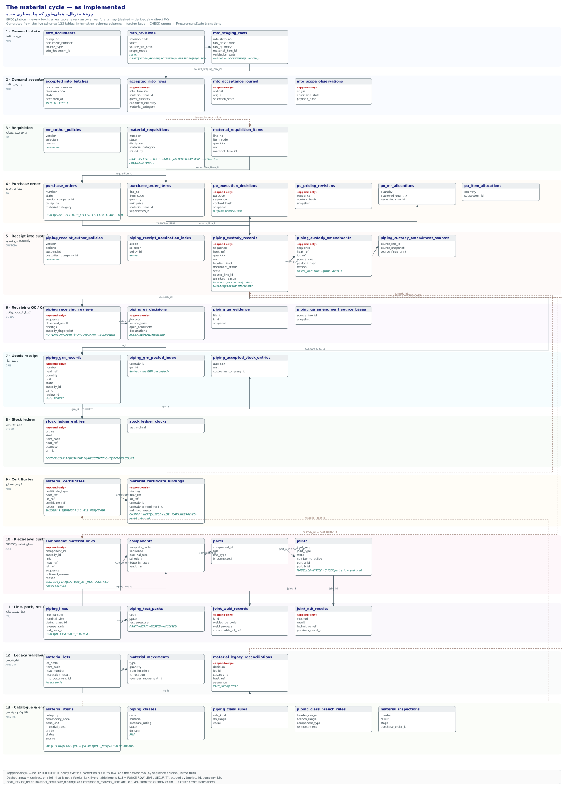

# The material cycle — as implemented (EN)

*Generated 2026-10-31 from the live schema. Every box in the diagram is a real
table; every arrow is a real foreign key unless it is dashed.*



If the preview cannot render the SVG, use the rasterised **[MATERIAL-CYCLE-uml.png](MATERIAL-CYCLE-uml.png)** — same diagram, generated by `convert -density 150`.

Regenerate it with `scripts/generate-material-cycle-uml.py` (Python 3, no
dependencies). The class list in that script is curated, not scraped — after a
schema change, re-read the source of truth before editing it:

```sql
-- columns
SELECT c.relname, a.attname, format_type(a.atttypid, a.atttypmod), a.attnotnull
  FROM pg_class c JOIN pg_namespace n ON n.oid = c.relnamespace
  JOIN pg_attribute a ON a.attrelid = c.oid
 WHERE n.nspname = 'public' AND c.relkind = 'r' AND a.attnum > 0 AND NOT a.attisdropped
 ORDER BY 1, a.attnum;

-- foreign keys
SELECT conrelid::regclass, conkey, confrelid::regclass, confkey
  FROM pg_constraint WHERE contype = 'f' AND connamespace = 'public'::regnamespace;
```

## 1 · The spine

| # | Stage | Tables | The sentence it records |
|---|-------|--------|-------------------------|
| 1–2 | Demand (MTO) | `mto_documents`, `mto_revisions`, `mto_staging_rows` → `accepted_mto_batches`, `accepted_mto_rows`, `mto_acceptance_journal`, `mto_scope_observations` | What the engineering MTO says we need, and what of it was accepted. |
| 3 | Requisition (MR) | `material_requisitions`, `material_requisition_items`, `mr_author_policies` | What we asked procurement to buy. |
| 4 | Purchase order | `purchase_orders`, `purchase_order_items`, `po_execution_decisions`, `po_pricing_revisions`, `po_mr_allocations`, `po_item_allocations` | What we committed to a vendor, and which requisition line it covers. |
| 5 | Receipt into custody | `piping_receipt_author_policies`, `piping_receipt_nomination_index`, `piping_custody_records`, `piping_custody_amendments`, `piping_custody_amendment_sources` | What physically arrived — **and which heat**. |
| 6 | Receiving QC / QA | `piping_receiving_reviews`, `piping_qa_decisions`, `piping_qa_evidence`, `piping_qa_amendment_source_bases` | Whether what arrived is acceptable, and on whose authority. |
| 7 | Goods receipt | `piping_grn_records`, `piping_grn_posted_index`, `piping_accepted_stock_entries` | That accepted material became a numbered GRN. One GRN per custody, ever. |
| 8 | Stock ledger | `stock_ledger_entries`, `stock_ledger_clocks` | The ordinal movement ledger: `RECEIPT`, `ISSUE`, `ADJUSTMENT_IN`, `ADJUSTMENT_OUT`, `OPENING_COUNT`. |
| 9 | Certificates (MTR) | `material_certificates`, `material_certificate_bindings` | That heat `H` of item `I` meets a specification — **bound to the receipt that attests it**. |
| 10 | Piece-level custody | `component_material_links`, `components`, `ports`, `joints` | **Which piece was cut from which receipt** (ADR-048 A.4b, 2026-10-31). |
| 11 | Line, pack, results | `piping_lines`, `piping_test_packs`, `joint_weld_records`, `joint_ndt_results` | What was built, what was welded, what was examined, and what pack it is in. |
| 12 | Legacy warehouse | `material_lots`, `material_movements`, `material_legacy_reconciliations` | The old lot/heat world, reconciled one decision at a time (`TAKE_OVER` / `RETIRE`). |
| 13 | Catalogue & engineering | `material_items`, `piping_classes`, `piping_class_rules`, `piping_class_branch_rules`, `material_inspections` | The identity every other stage refers to. |

## 2 · Where identity is decided: heat and lot

A heat number is the one fact that ties the whole cycle together, and the
platform is strict about **who is allowed to state it**:

- **Stated once, by the receiver.** `piping_custody_records.heat_ref` is written
  at receipt, and `piping_custody_amendments.heat_ref` / `.lot_ref` when the
  chain is corrected.
- **Derived everywhere else.** `piping_grn_records.heat_ref`,
  `stock_ledger_entries.heat_ref`, `material_certificate_bindings.heat_ref` /
  `.lot_ref` and `component_material_links.heat_ref` / `.lot_ref` are all
  **written by a guard from the custody chain**, never by a caller. A raw SQL
  insert that claims a different heat is silently corrected to the chain's own
  claim.

That is why a lot the custody chain does not attest is a refusal rather than a
downgrade: recording at heat level would make the data say “this lot is covered”
when custody only ever knew the heat.

`component_material_links` is the one place where a heat may be **stated without
a receipt** — and then only as `OBSERVED`, with a reason, so a dossier can always
tell “traced to a receipt” from “someone read a stamp”.

## 3 · State machines

```
MR   DRAFT → SUBMITTED → TECHNICAL_APPROVED → APPROVED → ORDERED
                ↓              ↓
             REJECTED ─────→ DRAFT        (rejection is a correction, not a dead end)

PO   DRAFT → ISSUED → PARTIALLY_RECEIVED → RECEIVED
              ↓              ↓
           CANCELLED     CANCELLED        (receipt progress is recomputed from the
                                           ledger, never nudged)

MTO  revision: DRAFT | UNDER_REVIEW | ACCEPTED | SUPERSEDED | REJECTED
     staging row: ACCEPTABLE | BLOCKED_UNMATCHED_MATERIAL | BLOCKED_UNIT_INCOMPATIBLE
                  | BLOCKED_DUPLICATE_IDENTITY | BLOCKED_QUANTITY_INVALID

RECEIPT  custody amendment source_kind: LINKED | UNRESOLVED
         receiving review: NO_NONCONFORMITY_OBSERVED | NONCONFORMITY_OBSERVED | INCOMPLETE
         QA decision: ACCEPTED | HOLD | REJECTED
         GRN: POSTED (there is no other state — a GRN is a fact)

PACK  DRAFT → READY → TESTED → ACCEPTED   (TESTED needs a result; ACCEPTED needs
                                           the LATEST result to be PASS; ACCEPTED
                                           is terminal)

JOINT MODELLED → FITTED

PIECE link: CUSTODY_HEAT | CUSTODY_LOT_HEAT | OBSERVED
MTR   binding: CUSTODY_HEAT | CUSTODY_LOT_HEAT | UNRESOLVED
```

## 4 · The append-only discipline

Every quality-bearing table in the cycle — custody records and amendments,
reviews, QA decisions, GRNs, stock ledger entries, certificates, bindings and
piece links — is **append-only**: there is no UPDATE and no DELETE policy under
RLS, so a write matches nothing, and a mutation trigger raises `55000` as a
second line of defence. A correction is a new row.

“The current answer” is therefore always the newest row by `sequence`
(custody amendments, piece links), `ordinal` (stock ledger), or `previous_*_id`
chaining (reviews, QA decisions, NDT results). Nothing in the platform edits
history to make the present look tidier.

## 5 · Two worlds, one reconciliation

The legacy warehouse (`material_lots` with `lot_code` / `heat_number`,
`material_movements`) is a separate world from the custody chain. They are joined
in exactly one place: `material_legacy_reconciliations`, an append-only decision
register that takes a lot over into custody (`TAKE_OVER`) or retires it
(`RETIRE`). Until a lot is reconciled it is *not* part of the traceability chain,
and the platform says so instead of guessing.

## 6 · Deliberately not built

- **No quantity accounting at piece level.** How much of a receipt a piece
  consumed — and whether that overruns what arrived — needs an issuance model
  the project has not declared. A number that gates nothing is worse than no
  number.
- **The dossier does not yet read any of this.** Receipts and certificates
  inside the ITR dossier are A.5b slice 3b, still open. What exists today is the
  join it will read: `epcc_joint_material_identity()` gives every joint its
  parent metal on both sides plus the filler lot, and
  `epcc_component_effective_material()` gives a piece its current heat.
- **No HTTP/UI for piece links.** Service-only, like every material slice so
  far.
- **Reconciling the legacy warehouse by quantity** is the ADR-047 cutover item,
  not this cycle.

## 7 · Mermaid source (for GitHub)

```mermaid
flowchart TD
  subgraph MTO
    MD[mto_documents] --> MR[mto_revisions] --> MS[mto_staging_rows]
    MS --> AB[accepted_mto_batches] --> AR[accepted_mto_rows]
    AR --> AJ[mto_acceptance_journal]
  end
  subgraph Requisition
    MRQ[material_requisitions] --> MRI[material_requisition_items]
  end
  subgraph Purchase
    PO[purchase_orders] --> POI[purchase_order_items]
    POI --> PED[po_execution_decisions]
    POI --> PMA[po_mr_allocations]
  end
  subgraph Custody
    CR[piping_custody_records] --> CA[piping_custody_amendments]
  end
  subgraph QC-QA
    RR[piping_receiving_reviews] --> QD[piping_qa_decisions]
  end
  subgraph GRN
    GRN[piping_grn_records] --> ASE[piping_accepted_stock_entries] --> SLE[stock_ledger_entries]
  end
  subgraph Certificates
    MC[material_certificates] --> MCB[material_certificate_bindings]
  end
  subgraph Piece-level
    CML[component_material_links] --> CMP[components] --> PRT[ports] --> JNT[joints]
    JNT --> JWR[joint_weld_records]
    JNT --> JNR[joint_ndt_results]
  end
  AR -.demand.-> MRI
  MRI --> POI
  POI --> CR
  CR --> RR
  QD --> GRN
  CR --> GRN
  GRN --> SLE
  MCB -.heat.-> CR
  CR -.heat DERIVED.-> CML
  CMP --> JNT
  LOT[material_lots] --> MLR[material_legacy_reconciliations] -.TAKE_OVER.-> CR
```
