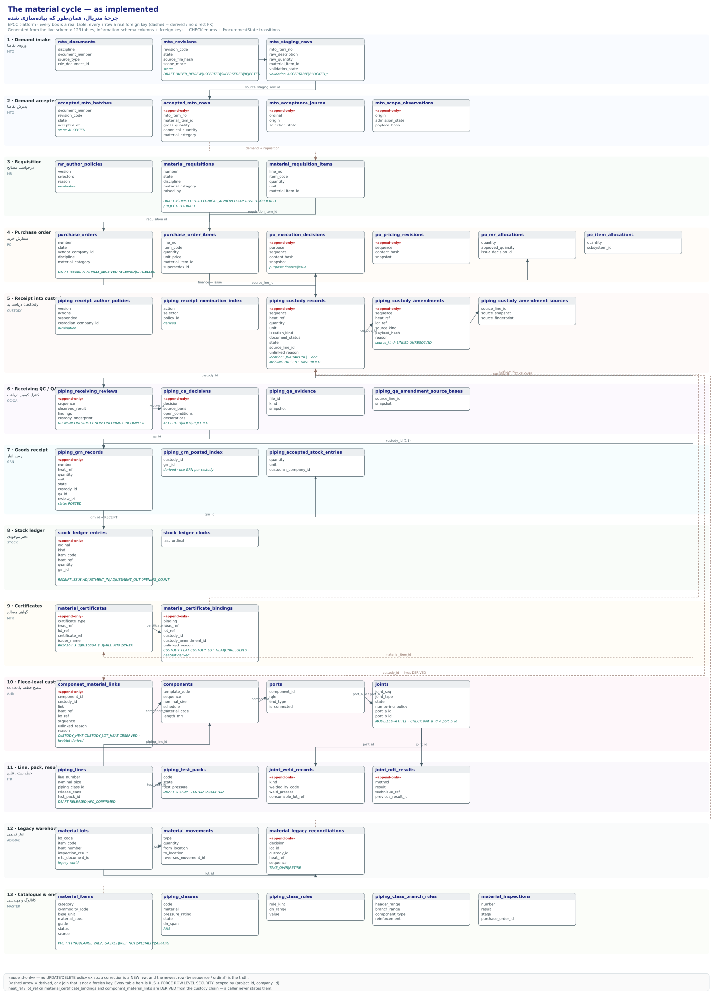

# چرخهٔ متریال — همان‌طور که پیاده‌سازی شده (FA)

*تولیدشده در ۲۰۲۶-۱۰-۳۱ از روی اسکیما ی زنده. هر جعبه یک جدولِ واقعی است و هر
پیکان یک کلیدِ خارجیِ واقعی — مگر آن‌که خط‌چین باشد.*



اگر نمایشگر نتواند SVG را نشان دهد، از **[MATERIAL-CYCLE-uml.png](MATERIAL-CYCLE-uml.png)** استفاده کنید — همان نمودار، خروجیِ `convert -density 150`.

برای تولیدِ دوباره: `scripts/generate-material-cycle-uml.py` (Python 3، بدون
وابستگی). فهرستِ کلاس‌ها در آن اسکریپت گلچین شده، نه استخراجِ خودکار؛ پس از هر
تغییرِ اسکیما، ابتدا منبعِ حقیقت را دوباره بخوانید (همان دو پرس‌وجوی
`information_schema` که در نسخهٔ EN آمده).

## ۱ · ستونِ فقرات

| # | مرحله | جداول | جمله‌ای که ثبت می‌کند |
|---|-------|-------|------------------------|
| ۱–۲ | تقاضا (MTO) | `mto_documents`، `mto_revisions`، `mto_staging_rows` → `accepted_mto_batches`، `accepted_mto_rows`، `mto_acceptance_journal`، `mto_scope_observations` | مهندسی چه خواسته و چه قدرش پذیرفته شده. |
| ۳ | درخواست (MR) | `material_requisitions`، `material_requisition_items`، `mr_author_policies` | از تدارکات چه خواسته‌ایم بخرند. |
| ۴ | سفارش (PO) | `purchase_orders`، `purchase_order_items`، `po_execution_decisions`، `po_pricing_revisions`، `po_mr_allocations`، `po_item_allocations` | به فروشنده چه تعهد داده‌ایم و کدام ردیفِ درخواست را می‌پوشاند. |
| ۵ | دریافت به custody | `piping_receipt_author_policies`، `piping_receipt_nomination_index`، `piping_custody_records`، `piping_custody_amendments`، `piping_custody_amendment_sources` | چه چیزی physically رسید — **و با کدام heat**. |
| ۶ | کنترل کیفیتِ دریافت | `piping_receiving_reviews`، `piping_qa_decisions`، `piping_qa_evidence`، `piping_qa_amendment_source_bases` | آنچه رسید قابل‌قبول هست یا نه، و به اختیارِ چه کسی. |
| ۷ | رسید انبار (GRN) | `piping_grn_records`، `piping_grn_posted_index`، `piping_accepted_stock_entries` | متریالِ پذیرفته‌شده صاحبِ یک رسیدِ شماره‌دار شد. هر custody فقط یک GRN، تا همیشه. |
| ۸ | دفترِ موجودی | `stock_ledger_entries`، `stock_ledger_clocks` | دفترِ ترتیبیِ حرکت‌ها: `RECEIPT`، `ISSUE`، `ADJUSTMENT_IN`، `ADJUSTMENT_OUT`، `OPENING_COUNT`. |
| ۹ | گواهی‌ها (MTR) | `material_certificates`، `material_certificate_bindings` | اینکه heat ی `H` از قلمِ `I` طبقِ کدام مشخصات است — **متصل به همان رسیدی که آن را تأیید می‌کند**. |
| ۱۰ | custody ی سطحِ قطعه | `component_material_links`، `components`، `ports`، `joints` | **این قطعه از کدام رسید بریده شده** (ADR-048 A.4b، ۲۰۲۶-۱۰-۳۱). |
| ۱۱ | خط، بسته، نتایج | `piping_lines`، `piping_test_packs`، `joint_weld_records`، `joint_ndt_results` | چه ساخته شد، چه جوش خورد، چه بازرسی شد و در کدام بسته است. |
| ۱۲ | انبارِ قدیمی | `material_lots`، `material_movements`، `material_legacy_reconciliations` | جهانِ قدیمیِ lot/heat که تصمیم‌به‌تصمیم آشتی داده می‌شود (`TAKE_OVER` / `RETIRE`). |
| ۱۳ | کاتالوگ و مهندسی | `material_items`، `piping_classes`، `piping_class_rules`، `piping_class_branch_rules`، `material_inspections` | هویتی که همهٔ مراحلِ دیگر به آن ارجاع می‌دهند. |

## ۲ · هویت کجا تعیین می‌شود: heat و lot

شمارهٔ heat همان تک‌واقعیتی است که کلِ چرخه را به هم می‌دوزد، و پلتفرم دربارهٔ
**چه کسی حق دارد آن را اعلام کند** سخت‌گیر است:

- **یک‌بار اعلام می‌شود، آن هم از سویِ تحویل‌گیرنده.** `piping_custody_records.heat_ref`
  هنگامِ دریافت نوشته می‌شود، و `piping_custody_amendments.heat_ref` / `.lot_ref`
  هنگامی که زنجیره اصلاح می‌شود.
- **در بقیهٔ جاها مشتق است.** `piping_grn_records.heat_ref`،
  `stock_ledger_entries.heat_ref`، `material_certificate_bindings.heat_ref` /
  `.lot_ref` و `component_material_links.heat_ref` / `.lot_ref` همگی را **نگهبان
  از زنجیرهٔ custody می‌نویسد**، نه فراخوان. یک insert ی خامِ SQL که heat ی دیگری
  ادعا کند، بی‌سر‌و‌صدا به ادعای خودِ زنجیره اصلاح می‌شود.

به همین دلیل lot ی که زنجیرهٔ custody تأییدش نکند یک **رد** است نه یک تنزّل:
ثبت در سطحِ heat یعنی داده بگوید «این lot پوشش دارد» در حالی که custody فقط
heat را می‌دانسته.

`component_material_links` تنها جایی است که یک heat می‌تواند **بدون رسید**
اعلام شود — آن هم فقط به‌صورت `OBSERVED` و با ذکرِ دلیل، تا dossier همیشه
«ردیابی‌شده تا رسید» را از «کسی یک مُهر را خوانده» تشخیص دهد.

## ۳ · ماشین‌های حالت

```
MR   DRAFT → SUBMITTED → TECHNICAL_APPROVED → APPROVED → ORDERED
                ↓              ↓
             REJECTED ─────→ DRAFT      (رد یک اصلاح است، نه بن‌بست)

PO   DRAFT → ISSUED → PARTIALLY_RECEIVED → RECEIVED
              ↓              ↓
           CANCELLED     CANCELLED      (پیشرفتِ دریافت از دفتر بازحسابی
                                         می‌شود، هرگز دستی جابه‌جا نمی‌شود)

MTO  revision: DRAFT | UNDER_REVIEW | ACCEPTED | SUPERSEDED | REJECTED
     staging row: ACCEPTABLE | BLOCKED_UNMATCHED_MATERIAL | BLOCKED_UNIT_INCOMPATIBLE
                  | BLOCKED_DUPLICATE_IDENTITY | BLOCKED_QUANTITY_INVALID

دریافت  source_kind: LINKED | UNRESOLVED
        بازرسیِ دریافت: NO_NONCONFORMITY_OBSERVED | NONCONFORMITY_OBSERVED | INCOMPLETE
        تصمیم QA: ACCEPTED | HOLD | REJECTED
        GRN: POSTED (حالتِ دیگری ندارد — رسید یک واقعیت است)

بسته  DRAFT → READY → TESTED → ACCEPTED  (TESTED نتیجه می‌خواهد؛ ACCEPTED اینکه
                                          آخرین نتیجه PASS باشد؛ ACCEPTED پایانی است)

اتصال  MODELLED → FITTED

قطعه  پیوند: CUSTODY_HEAT | CUSTODY_LOT_HEAT | OBSERVED
MTR   اتصال: CUSTODY_HEAT | CUSTODY_LOT_HEAT | UNRESOLVED
```

## ۴ · انضباطِ فقط‌الحاقی

هر جدولِ کیفی در این چرخه — رکوردها و اصلاحیه‌های custody، بازرسی‌ها، تصمیم‌های
QA، رسیدها، ردیف‌های دفترِ موجودی، گواهی‌ها، اتصال‌ها و پیوندهای قطعه —
**فقط‌الحاقی** است: policy ی UPDATE و DELETE اصلاً وجود ندارد، پس نوشتن به هیچ
ردیفی نمی‌خورد، و تریگرِ جهش با `55000` خطِ دومِ دفاع است. اصلاح یعنی ردیفِ جدید.

بنابراین «پاسخِ جاری» همیشه newest ترین ردیف است — بر حسبِ `sequence`
(اصلاحیه‌های custody، پیوندهای قطعه)، `ordinal` (دفترِ موجودی) یا زنجیرهٔ
`previous_*_id` (بازرسی‌ها، تصمیم‌های QA، نتایجِ NDT). هیچ چیز در این پلتفرم
تاریخ را ویرایش نمی‌کند تا امروز مرتب‌تر به نظر برسد.

## ۵ · دو جهان، یک آشتی

انبارِ قدیمی (`material_lots` با `lot_code` / `heat_number` و
`material_movements`) جهانی جداست از زنجیرهٔ custody. این دو فقط در یک نقطه به هم
می‌رسند: `material_legacy_reconciliations` — دفترِ تصمیمِ فقط‌الحاقی که یک lot را
به custody منتقل می‌کند (`TAKE_OVER`) یا بازنشسته‌اش می‌کند (`RETIRE`). تا وقتی
یک lot آشتی داده نشده، **بخشی از زنجیرهٔ ردیابی نیست** و پلتفرم همین را می‌گوید
به‌جای اینکه حدس بزند.

## ۶ · آنچه عمداً ساخته نشده

- **هیچ حسابِ مقداری در سطحِ قطعه.** اینکه یک قطعه چه قدر از یک رسید مصرف کرده —
  و اینکه آیا از موجودیِ رسیده جلو زده — مدلِ صدور و تحویلی می‌خواهد که پروژه
  اعلام نکرده. عددی که چیزی را گِیت نمی‌کند از نبودنش بدتر است.
- **dossier هنوز هیچ‌کدام از این‌ها را نمی‌خواند.** آمدنِ رسیدها و گواهی‌ها درونِ
  dossier ی ITR برش ۳b از A.5b است و هنوز باز است. آنچه امروز هست همان اتصالی
  است که آن برش خواهد خواند: `epcc_joint_material_identity()` فلزِ پایهٔ هر دو
  سمتِ هر جوش را به‌همراه lotِ مصرفی می‌دهد، و
  `epcc_component_effective_material()` heat ی جاریِ یک قطعه را.
- **هیچ صفحه‌ای برای پیوندِ قطعه.** فقط سرویس، مثل همهٔ برش‌های متریال تا امروز.
- **آشتیِ مقداریِ انبارِ قدیمی** کارِ cutover ی ADR-047 است، نه این چرخه.
